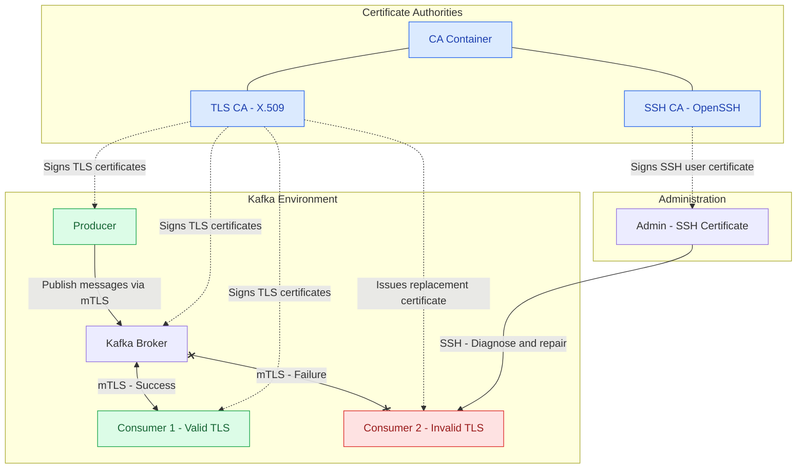

# SSH & TLS Lab

## Overview

The goal of this lab is to understand how **OpenSSL, OpenSSH certificates,
Certificate Authorities (CAs), and mutual TLS (mTLS)** work in practice.

To achieve this, I'll use multiple Docker containers to simulate a
Kafka-based messaging environment in which a producer publishes messages to
a broker and multiple consumers subscribe to those messages.

Communication between Kafka clients and the broker will be secured using
**mutual TLS (mTLS)**, allowing both parties to authenticate each other
using X.509 certificates issued by a trusted TLS Certificate Authority.

Additionally, **OpenSSH certificates** will be used to authenticate an
administrator who can access the containers, troubleshoot
certificate-related issues, and restore connectivity.

The lab will use two independent Certificate Authorities (same docker
container; but, different cryptographic keys and trust configurations):

- **TLS CA:** Responsible for signing X.509 certificates used for Kafka
  mTLS connections.
- **SSH CA:** Responsible for signing OpenSSH certificates used for
  administrative access.

## Lab Components

The environment will consist of the following containers:

- **`ca`**: Certificate Authority responsible for issuing and signing TLS
  and SSH certificates. It will maintain two independent CA key pairs, one
  for each certificate system.

- **`producer`**: Kafka producer that periodically generates and publishes
  messages to a topic through the Kafka broker. It authenticates with the
  broker using mTLS.

- **`consumer_1`**: A correctly configured Kafka consumer with a valid TLS
  certificate. It can successfully authenticate with the broker, subscribe
  to the topic, and receive messages from the beginning of the lab.

- **`consumer_2`**: A Kafka consumer intentionally configured with an
  invalid, expired, or untrusted TLS certificate. Its initial connection to
  the broker fails due to mTLS authentication errors. The administrator's
  task is to diagnose and resolve this issue.

- **`admin`**: Container simulating an administrator's workstation. The
  administrator uses an SSH certificate signed by the trusted SSH CA to
  authenticate with the target containers, investigate the certificate
  issues affecting `consumer_2`, and restore its connectivity.

- **`broker`**: Kafka broker responsible for managing topics, accepting
  producer and consumer connections, and delivering messages. It uses TLS
  certificates to authenticate itself to clients and verify client
  certificates when mTLS is enabled.

## Architecture Diagram

## Final Goal

The final objective is to demonstrate a complete certificate lifecycle,
from **CA creation and certificate issuance to authentication, failure
diagnosis, certificate replacement, and service recovery**.

This lab should provide practical experience with both TLS-based service
authentication and certificate-based SSH administration in a containerized
Kafka environment.
